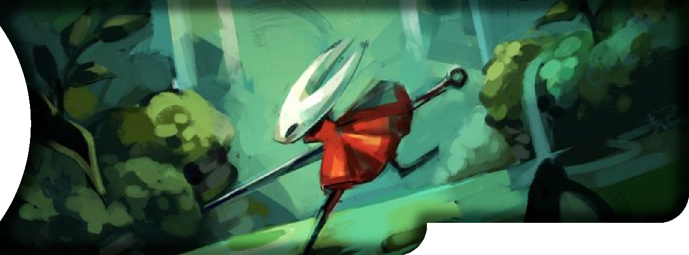

## Bom dia, boa tarde, boa noite!
Aqui é o seu programador quase preferido, Matheus.

Brincadeiras a parte, sou estudante de ADS na Fatec Ourinhos e estou construindo minha jornada na programação.

Atualmente, estudo Java, Python e C. Gosto de entender o que acontece por trás do código e ver o que faz ele funcionar.

Aqui compartilho projetos, exercícios e aprendizados dessa jornada. Estou sempre aberto a trocar ideias e aprender com outras pessoas.
