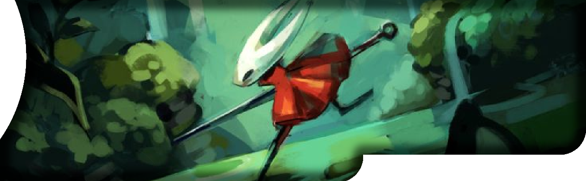

## Good morning, good afternoon, and good evening!
It’s your friendly neighborhood developer, Matheus.

I'm a **Systems Analysis and Development** student from Brazil building my journey in programming.

Currently, I'm studying **Java**, **Python**, and **C**. I enjoy understanding what happens under the hood and seeing what makes the code work.

Here, I share projects, exercises, and lessons learned along the way. I'm always open to exchanging ideas and learning from others!

## Bom dia, boa tarde, boa noite!
Aqui é o seu programador quase preferido, Matheus.

Brincadeiras a parte, sou estudante de **Análise e Desenvolvimento de Sistemas** na **Fatec Ourinhos** e estou construindo minha jornada na programação.

Atualmente, estudo **Java**, **Python** e **C**. Gosto de entender o que acontece por trás do código e ver o que faz ele funcionar.

Aqui compartilho projetos, exercícios e aprendizados dessa jornada. Estou sempre aberto a trocar ideias e aprender com outras pessoas.
